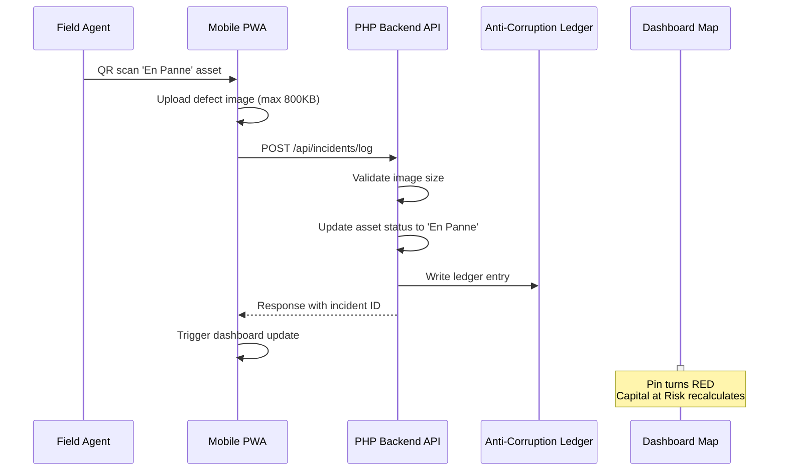
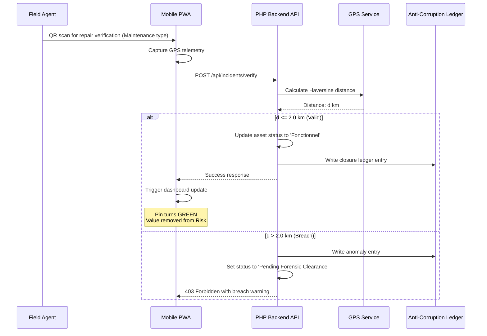
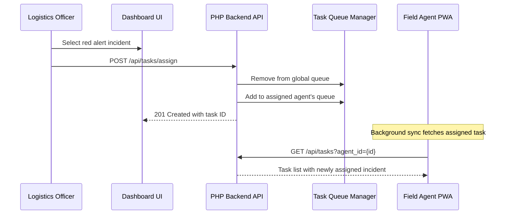

# Design Document: ATIMS Asset Tracking and Infrastructure Management System

## Overview

The Asset Tracking and Infrastructure Management System (ATIMS) provides comprehensive control, tracking, and auditability over state infrastructure and physical property. This document describes the architectural design for the newly added **Incident & Breakdown Operational Workflow (Requirement 14)**, which implements a closed-loop lifecycle for asset failures from incident logging through forensic closure.

### System Context

The system operates across four distinct user roles:
- **Field Agent**: Performs field audits and inspections
- **Logistics Officer**: Manages asset onboarding and user provisioning
- **State Auditor**: Conducts forensic tracking and compliance verification
- **Executive**: Monitors strategic dashboards

The target stack is Angular (Frontend PWA) | PHP (Backend API) | MySQL 8.0+ (Database), with staging on shared hosting and production on dedicated servers.

### New Workflow: Incident & Breakdown Operational Workflow

Requirement 14 adds a complete incident management lifecycle:

1. **Incident Logging**: QR scan + defect image triggers 'En Panne' status
2. **Dashboard Orchestration**: Leaflet.js map updates without full refresh
3. **Logistics Dispatch**: Assign Field Agent, task removed from global queue
4. **Repair Validation**: Rescan for 'Maintenance' inspection with Haversine distance check
5. **Forensic Closure**: Distance verification updates to 'Fonctionnel', writes ledger entry

This workflow integrates with existing capabilities:
- Geo-fencing (Requirement 4): Haversine distance calculation for drift detection
- Anti-Corruption Ledger (Requirement 5): Immutable audit trail for all changes
- Offline Operations (Requirement 7): Support for field operations without connectivity
- QR Code Generation (Requirement 6): Asset identification via QR scanning

## Architecture

### Layered Architecture

```
┌─────────────────────────────────────────────────────────────────────┐
│                         Frontend (Angular PWA)                      │
│  ┌──────────────┐  ┌──────────────┐  ┌──────────────┐              │
│  │  Map Module  │  │  Dashboard   │  │  Mobile PWA  │              │
│  │ (Leaflet.js) │  │   (KPIs)     │  │ (Offline First)│             │
│  └──────────────┘  └──────────────┘  └──────────────┘              │
│                            ↓                                        │
│  ┌──────────────────────────────────────────────────────────────┐   │
│  │                 Service Layer (HTTP Client)                   │   │
│  └──────────────────────────────────────────────────────────────┘   │
└─────────────────────────────────────────────────────────────────────┘
                                    ↓
┌─────────────────────────────────────────────────────────────────────┐
│                      Backend (PHP API)                              │
│  ┌──────────────┐  ┌──────────────┐  ┌──────────────┐              │
│  │  Incident    │  │  Ledger      │  │  Queue       │              │
│  │  Service     │  │  Service     │  │  Manager     │              │
│  └──────────────┘  └──────────────┘  └──────────────┘              │
│  ┌──────────────┐  ┌──────────────┐  ┌──────────────┐              │
│  │  GPS Service │  │  File        │  │  Auth & RBAC │              │
│  │  (Haversine) │  │  Service     │  │  Service     │              │
│  └──────────────┘  └──────────────┘  └──────────────┘              │
└─────────────────────────────────────────────────────────────────────┘
                                    ↓
┌─────────────────────────────────────────────────────────────────────┐
│                      Database (MySQL 8.0+)                          │
│  ┌──────────────┐  ┌──────────────┐  ┌──────────────┐              │
│  │  Assets      │  │  Inspections │  │  Ledgers     │              │
│  │  (Spatial)   │  │  Records     │  │  (Append-only)│             │
│  └──────────────┘  └──────────────┘  └──────────────┘              │
│  ┌──────────────┐  ┌──────────────┐                                 │
│  │  Queues      │  │  Attachments │                                 │
│  │  (Tasks)     │  │  Index       │                                 │
│  └──────────────┘  └──────────────┘                                 │
└─────────────────────────────────────────────────────────────────────┘
```

### Technology Stack

| Layer | Technology | Purpose |
|-------|-----------|---------|
| Frontend | Angular 16+ | Progressive Web App with offline support |
| Maps | Leaflet.js 1.9.4 | Interactive dashboard mapping |
| Backend | PHP 8.2+ | RESTful API endpoints |
| Database | MySQL 8.0+ | Spatial data with geometry point support |
| Storage | LocalStorage + IndexedDB | PWA offline data persistence |
| QR Codes | JsQR / html5-qrcode | Mobile QR scanning |

## Components and Interfaces

### Incident Management Module



### Repair Validation Workflow



### Task Assignment Workflow



## Data Models

### Asset Table (`assets`)

| Column | Type | Description |
|--------|------|-------------|
| id | BIGINT UNSIGNED | Auto-incrementing primary key |
| state_id | VARCHAR(64) | Unique state identifier |
| name | VARCHAR(255) | Asset name/title |
| description | TEXT | Detailed description |
| category_id | BIGINT UNSIGNED | Foreign key to categories |
| registered_location | VARCHAR(255) | Human-readable location |
| latitude | DECIMAL(10,8) | GPS latitude (WGS 84) |
| longitude | DECIMAL(11,8) | GPS longitude (WGS 84) |
| location_point | POINT | MySQL geometry point (spatial index) |
| acquisition_date | DATE | Date of acquisition |
| purchase_value | DECIMAL(15,2) | Original purchase value |
| current_value | DECIMAL(15,2) | Current assessed value |
| current_status | ENUM('Fonctionnel','En Panne','Déclassé','Inconnu') | Current operational status |
| parent_asset_id | BIGINT UNSIGNED | Self-referencing for compound assets |
| created_at | TIMESTAMP | Creation timestamp |
| updated_at | TIMESTAMP | Last update timestamp |

### Inspections Table (`inspections`)

| Column | Type | Description |
|--------|------|-------------|
| id | BIGINT UNSIGNED | Auto-incrementing primary key |
| asset_id | BIGINT UNSIGNED | Foreign key to assets |
| user_id | BIGINT UNSIGNED | Foreign key to users (Field Agent) |
| inspection_type | ENUM('Routine','Breakdown','Maintenance','Handover') | Type of inspection |
| condition_status | ENUM('Fonctionnel','En Panne','Déclassé','Inconnu') | Asset condition at inspection |
| field_notes | TEXT | Free-text notes from agent |
| verification_image | VARCHAR(255) | Path to uploaded image |
| device_latitude | DECIMAL(10,8) | GPS latitude at inspection time |
| device_longitude | DECIMAL(11,8) | GPS longitude at inspection time |
| device_timestamp | TIMESTAMP | Local device timestamp |
| created_at | TIMESTAMP | Inspection timestamp |

### Anti-Corruption Ledger Table (`ledgers`)

| Column | Type | Description |
|--------|------|-------------|
| id | BIGINT UNSIGNED | Auto-incrementing primary key |
| event_type | ENUM('Status Change','Asset Update','Location Drift Anomaly','Repair Closure','Other') | Type of event |
| table_name | VARCHAR(64) | Affected table name |
| record_id | BIGINT UNSIGNED | Affected record ID |
| old_data | JSON | Previous state (for updates) |
| new_data | JSON | New state |
| user_id | BIGINT UNSIGNED | User who made the change |
| ip_address | VARCHAR(45) | Network IP address (IPv4/IPv6) |
| device_type | VARCHAR(64) | Device type (mobile/desktop) |
| metadata | JSON | Event-specific metadata (e.g., Haversine distance) |
| created_at | TIMESTAMP | Immutable event timestamp |

### Task Queue Table (`task_queues`)

| Column | Type | Description |
|--------|------|-------------|
| id | BIGINT UNSIGNED | Auto-incrementing primary key |
| task_type | ENUM('Incident Assignment','Maintenance Schedule','Routine Inspection','Drift Review') | Type of task |
| asset_id | BIGINT UNSIGNED | Foreign key to assets (if applicable) |
| assigned_user_id | BIGINT UNSIGNED | Foreign key to user (Field Agent) |
| global_queue_order | INT | Position in global queue (null if assigned) |
| status | ENUM('Pending','Assigned','In Progress','Completed','Cancelled') | Task status |
| due_date | DATE | Optional due date |
| created_at | TIMESTAMP | Task creation timestamp |
| completed_at | TIMESTAMP | Completion timestamp (nullable) |

### Attachments Index Table (`attachments`)

| Column | Type | Description |
|--------|------|-------------|
| id | BIGINT UNSIGNED | Auto-incrementing primary key |
| asset_id | BIGINT UNSIGNED | Foreign key to assets |
| user_id | BIGINT UNSIGNED | Foreign key to users |
| inspection_log_id | BIGINT UNSIGNED | Foreign key to inspections (nullable) |
| ledger_event_id | BIGINT UNSIGNED | Foreign key to ledgers (nullable) |
| file_path | VARCHAR(255) | Path to stored file |
| file_name | VARCHAR(255) | Original filename |
| file_size | BIGINT UNSIGNED | File size in bytes |
| file_type | VARCHAR(32) | MIME type |
| created_at | TIMESTAMP | Upload timestamp |

### Users Table (Extension for Queue Management)

| Column | Type | Description |
|--------|------|-------------|
| id | BIGINT UNSIGNED | Primary key |
| username | VARCHAR(64) | Unique username |
| role | ENUM('Logistics Officer','Field Agent','State Auditor','Executive') | User role |
| email | VARCHAR(255) | Email address |
| mfa_enabled | TINYINT(1) | MFA enabled flag |
| mfa_secret | VARCHAR(255) | TOTP secret (if enabled) |
| last_login | TIMESTAMP | Last successful login |
| created_at | TIMESTAMP | Account creation timestamp |

## API Endpoints

### Incident Management

| Method | Endpoint | Description | Role | Authentication |
|--------|----------|-------------|------|----------------|
| POST | `/api/incidents/log` | Log incident with QR scan and defect image | Field Agent | JWT |
| POST | `/api/incidents/verify` | Verify repair with GPS telemetry | Field Agent | JWT |
| GET | `/api/incidents/unresolved` | Get all unresolved incidents | Logistics Officer | JWT |
| GET | `/api/incidents/history/{assetId}` | Get incident history for asset | State Auditor | JWT |

### Task Management

| Method | Endpoint | Description | Role | Authentication |
|--------|----------|-------------|------|----------------|
| POST | `/api/tasks/assign` | Assign incident to Field Agent | Logistics Officer | JWT |
| POST | `/api/tasks/{task}/claim` | Claim task from global queue | Field Agent | JWT |
| GET | `/api/tasks?agent_id={id}` | Get tasks for Field Agent | Field Agent | JWT |
| PUT | `/api/tasks/{id}` | Update task status | Field Agent | JWT |
| DELETE | `/api/tasks/{id}` | Cancel task | Logistics Officer | JWT |
| GET | `/api/tasks/global-queue` | Get global task queue | Field Agent | JWT |

### Dashboard Updates

| Method | Endpoint | Description | Role | Authentication |
|--------|----------|-------------|------|----------------|
| GET | `/api/dashboards/kpi` | Get real-time KPIs | Executive | JWT |
| GET | `/api/dashboards/map-pins` | Get updated map pins (delta) | All | JWT |

### Data Models (Requests/Responses)

**Incident Log Request:**
```json
{
  "asset_id": 123,
  "qr_code_data": "ATIMS-000000123",
  "defect_image_path": "/uploads/defect_123.jpg",
  "field_notes": "Visible damage to chassis, asset not operational",
  "device_latitude": 48.8566,
  "device_longitude": 2.3522,
  "device_timestamp": "2024-01-15T14:30:00Z"
}
```

**Incident Log Response:**
```json
{
  "incident_id": 456,
  "asset_id": 123,
  "asset_status": "En Panne",
  "ledger_entry_id": 789,
  "capital_at_risk": 15000.00
}
```

**Repair Verification Request:**
```json
{
  "asset_id": 123,
  "inspection_type": "Maintenance",
  "condition_status": "Fonctionnel",
  "field_notes": "Replaced damaged component, tested functionality",
  "device_latitude": 48.8568,
  "device_longitude": 2.3524,
  "device_timestamp": "2024-01-16T09:15:00Z"
}
```

**Repair Verification Response (Success):**
```json
{
  "status": "Fonctionnel",
  "ledger_entry_id": 790,
  "distance_from_base_km": 0.25,
  "message": "Asset verified and restored to Fonctionnel status"
}
```

**Repair Verification Response (Breach):**
```json
{
  "error": "Location Drift Anomaly",
  "distance_from_base_km": 3.45,
  "threshold_km": 2.0,
  "ledger_entry_id": 789,
  "message": "GPS coordinates exceed 2.0km threshold. Asset placed in 'Pending Forensic Clearance' state."
}
```

**Task Assignment Request:**
```json
{
  "incident_id": 456,
  "assigned_user_id": 789,
  "priority": "High",
  "assigned_by_user_id": 101
}
```

**Task Assignment Response:**
```json
{
  "task_id": 1024,
  "incident_id": 456,
  "assigned_user_id": 789,
  "assigned_user_name": "Jean Dupont",
  "global_queue_position_removed": true,
  "message": "Task assigned to Field Agent"
}
```

**Task Claim Request:**
```json
// No body required - task ID in path
```

**Task Claim Response:**
```json
{
  "message": "Task claimed successfully",
  "task": {
    "id": 1025,
    "task_type": "Incident Assignment",
    "asset_id": 123,
    "asset_name": "Dump Truck #45",
    "status": "Assigned",
    "assigned_user_id": 789,
    "due_date": "2024-01-20"
  }
}
```

## Frontend Architecture

### Angular Module Structure

```
src/app/
├── core/                   # Core services and interceptors
│   ├── services/
│   │   ├── api.service.ts  # HTTP client wrapper
│   │   ├── auth.service.ts # Authentication
│   │   └── sync.service.ts # Offline sync coordinator
│   └── guards/
│       ├── auth.guard.ts
│       └── role.guard.ts
├── shared/                 # Shared components and directives
│   ├── components/
│   │   ├── map/
│   │   │   ├── map.component.ts     # Leaflet.js wrapper
│   │   │   ├── map-pin.directive.ts
│   │   │   └── map.service.ts       # Map state management
│   │   ├── kpi/
│   │   │   ├── kpi-card.component.ts
│   │   │   └── kpi.service.ts       # KPI calculations
│   │   └── qr-scanner/
│   │       ├── qr-scanner.component.ts
│   │       └── qr-scanner.service.ts
│   └── directives/
│       └── offline-indicator.directive.ts
├── features/               # Feature modules
│   ├── incidents/
│   │   ├── incidents-routing.module.ts
│   │   ├── incidents.component.ts
│   │   ├── incident-list/
│   │   │   ├── incident-list.component.ts
│   │   │   └── incident-list.service.ts
│   │   ├── incident-detail/
│   │   │   ├── incident-detail.component.ts
│   │   │   └── incident-detail.service.ts
│   │   └── incident-log/
│   │       ├── incident-log.component.ts
│   │       └── incident-log.service.ts
│   ├── dashboard/
│   │   ├── dashboard.component.ts
│   │   ├── dashboard-routing.module.ts
│   │   └── kpi-widget/
│   │       ├── kpi-widget.component.ts
│   │       └── capital-at-risk.service.ts
│   └── tasks/
│       ├── tasks.component.ts
│       ├── tasks-routing.module.ts
│       └── task-assignment/
│           ├── task-assignment.component.ts
│           └── task-assignment.service.ts
└── app-routing.module.ts
```

### PWA Manifest and Service Worker

**`ngsw-config.json`:**
```json
{
  "index": "/index.html",
  "assetGroups": [
    {
      "name": "app",
      "installMode": "prefetch",
      "resources": {
        "files": [
          "/favicon.ico",
          "/index.html",
          "/manifest.webmanifest",
          "/*.css",
          "/*.js"
        ]
      }
    },
    {
      "name": "assets",
      "installMode": "lazy",
      "updateMode": "prefetch",
      "resources": {
        "files": [
          "/assets/**",
          "/*.(eot|svg|cur|jpg|png|webp|gif|otf|ttf|woff|woff2|ani)"
        ]
      }
    }
  ],
  "dataGroups": [
    {
      "name": "api-cache",
      "urls": [
        "/api/incidents/**",
        "/api/tasks/**",
        "/api/dashboards/**"
      ],
      "cacheConfig": {
        "maxSize": 100,
        "maxAge": "3d",
        "strategy": "freshness"
      }
    }
  ]
}
```

### Map Component Implementation

**`map.component.ts`:**
```typescript
import { Component, OnInit, OnDestroy } from '@angular/core';
import * as L from 'leaflet';
import { MapService } from './map.service';

@Component({
  selector: 'app-map',
  template: `<div #mapContainer class="map-container"></div>`
})
export class MapComponent implements OnInit, OnDestroy {
  private map!: L.Map;
  private pins: Map<number, L.Marker> = new Map();
  
  constructor(private mapService: MapService) {}
  
  ngOnInit(): void {
    this.map = L.map('mapContainer').setView([48.8566, 2.3522], 13);
    
    L.tileLayer('https://{s}.tile.openstreetmap.org/{z}/{x}/{y}.png', {
      attribution: '© OpenStreetMap contributors'
    }).addTo(this.map);
    
    this.mapService.pins$.subscribe(pins => this.updatePins(pins));
  }
  
  updatePins(pins: MapPin[]): void {
    // Remove pins not in new data
    this.pins.forEach((marker, id) => {
      if (!pins.find(p => p.assetId === id)) {
        this.map.removeLayer(marker);
        this.pins.delete(id);
      }
    });
    
    // Add/update pins
    pins.forEach(pin => {
      if (this.pins.has(pin.assetId)) {
        this.pins.get(pin.assetId)!.setIcon(this.getIcon(pin.status));
      } else {
        const marker = L.marker([pin.latitude, pin.longitude], {
          icon: this.getIcon(pin.status)
        }).addTo(this.map);
        marker.bindTooltip(`Asset #${pin.assetId}: ${pin.status}`);
        this.pins.set(pin.assetId, marker);
      }
    });
  }
  
  getIcon(status: string): L.Icon {
    switch (status) {
      case 'Fonctionnel': return L.icon({ iconUrl: '/assets/icons/green-pin.png', ... });
      case 'En Panne': return L.icon({ iconUrl: '/assets/icons/red-pin.png', ... });
      default: return L.icon({ iconUrl: '/assets/icons/gray-pin.png', ... });
    }
  }
  
  ngOnDestroy(): void {
    this.map.remove();
  }
}
```

### Capital at Risk Service

**`capital-at-risk.service.ts`:**
```typescript
import { Injectable } from '@angular/core';
import { BehaviorSubject } from 'rxjs';
import { Incident } from '../models/incident';

@Injectable({
  providedIn: 'root'
})
export class CapitalAtRiskService {
  private riskAmount = new BehaviorSubject<number>(0);
  risk$ = this.riskAmount.asObservable();
  
  constructor(private incidentService: IncidentService) {
    this.loadRiskAmount();
  }
  
  async loadRiskAmount(): Promise<void> {
    const incidents = await this.incidentService.getUnresolved().toPromise();
    const total = incidents
      .filter(i => i.asset.current_status === 'En Panne')
      .reduce((sum, i) => sum + (i.asset.current_value || 0), 0);
    this.riskAmount.next(total);
  }
  
  async handleIncidentStatusChange(assetId: number, newStatus: string): Promise<void> {
    const incidents = await this.incidentService.getUnresolved().toPromise();
    const updatedIncident = incidents.find(i => i.asset_id === assetId);
    
    if (!updatedIncident) return;
    
    let currentRisk = this.riskAmount.value;
    
    // If asset changed to 'En Panne', add its value to risk
    if (newStatus === 'En Panne' && updatedIncident.asset.current_value) {
      currentRisk += updatedIncident.asset.current_value;
    } 
    // If asset changed to 'Fonctionnel', remove its value from risk
    else if (newStatus === 'Fonctionnel' && updatedIncident.asset.current_value) {
      currentRisk -= updatedIncident.asset.current_value;
    }
    
    this.riskAmount.next(currentRisk);
  }
}
```

## Security Architecture

### Authentication Flow

```
┌──────────────┐    1. Login    ┌────────────────┐
│   Frontend   │ ──────────────> │   PHP Backend  │
└──────────────┘                 └────────────────┘
                                      │ 2. Validate
                                      │ 3. Generate JWT
                                      │ 4. Return Token
                                      │
┌──────────────┐    5. Token      └────────────────┐
│   Frontend   │ ─────────────────> │   API Requests │
└──────────────┘   (Authorization Header)           └────────────────┘
```

### RBAC Enforcement

**`role.guard.ts`:**
```typescript
import { Injectable } from '@angular/core';
import { CanActivate, ActivatedRouteSnapshot, RouterStateSnapshot } from '@angular/router';
import { AuthService } from '../services/auth.service';

@Injectable({
  providedIn: 'root'
})
export class RoleGuard implements CanActivate {
  constructor(private authService: AuthService) {}
  
  canActivate(route: ActivatedRouteSnapshot, state: RouterStateSnapshot): boolean {
    const requiredRoles = route.data['roles'] as string[];
    const userRole = this.authService.getCurrentUser()?.role;
    
    if (!userRole) {
      this.authService.logout();
      return false;
    }
    
    return requiredRoles.includes(userRole);
  }
}
```

**Route Protection:**
```typescript
const routes: Routes = [
  {
    path: 'dashboard',
    component: DashboardComponent,
    canActivate: [RoleGuard],
    data: { roles: ['Executive', 'Logistics Officer'] }
  },
  {
    path: 'incidents/assign',
    component: TaskAssignmentComponent,
    canActivate: [RoleGuard],
    data: { roles: ['Logistics Officer'] }
  },
  {
    path: 'incidents/log',
    component: IncidentLogComponent,
    canActivate: [RoleGuard],
    data: { roles: ['Field Agent'] }
  }
];
```

### MFA Support

| MFA Method | Implementation | Fallback |
|------------|---------------|----------|
| TOTP | `speakeasy` library | N/A |
| SMS OTP | Twilio API integration | Email OTP |
| Email OTP | Nodemailer integration | N/A |

### API Security Middleware

**PHP Middleware:**
```php
<?php
// middleware/auth.php
function authenticateRequest(Request $request): User {
    $authHeader = $request->getHeaderLine('Authorization');
    
    if (empty($authHeader)) {
        throw new UnauthorizedException('Missing Authorization header');
    }
    
    // Extract token from "Bearer <token>"
    $token = str_replace('Bearer ', '', $authHeader);
    
    try {
        $payload = JWT::decode($token, new Key(getenv('JWT_SECRET'), 'HS256'));
        $user = UserRepository::findById($payload->user_id);
        
        if (!$user) {
            throw new UnauthorizedException('User not found');
        }
        
        // Check MFA if enabled
        if ($user->mfa_enabled && !$request->getHeaderLine('X-MFA-Verified')) {
            throw new UnauthorizedException('MFA required');
        }
        
        return $user;
    } catch (SignatureVerificationFailed $e) {
        throw new UnauthorizedException('Invalid token signature');
    }
}
?>
```

## Performance Optimization

### Database Indexing Strategy

```sql
-- Asset location lookup (Geo-fencing, Map rendering)
CREATE INDEX idx_assets_location_point ON assets (ST_Distance_Sphere(location_point, ST_PointFromText('POINT(0 0)')));
CREATE SPATIAL INDEX idx_assets_spatial ON assets (location_point);

-- Inspection lookup by asset
CREATE INDEX idx_inspections_asset_id ON inspections (asset_id);
CREATE INDEX idx_inspections_created_at ON inspections (created_at);

-- Ledger event lookup
CREATE INDEX idx_ledgers_table_record ON ledgers (table_name, record_id);
CREATE INDEX idx_ledgers_created_at ON ledgers (created_at);

-- Task queue lookups
CREATE INDEX idx_tasks_assigned_user ON task_queues (assigned_user_id, status);
CREATE INDEX idx_tasks_global_queue ON task_queues (global_queue_order) WHERE global_queue_order IS NOT NULL;

-- Attachments lookup
CREATE INDEX idx_attachments_asset ON attachments (asset_id);
CREATE INDEX idx_attachments_inspection ON attachments (inspection_log_id);
CREATE INDEX idx_attachments_ledger ON attachments (ledger_event_id);
```

### Query Optimization

**Geo-fencing Query (with spatial index):**
```sql
-- Efficient distance calculation using MySQL spatial functions
SELECT 
    id, name, 
    ST_AsText(location_point) as location,
    ST_Distance_Sphere(
        location_point, 
        ST_PointFromText(CONCAT('POINT(', ?, ' ', ?, ')'))
    ) as distance_meters
FROM assets 
WHERE ST_Distance_Sphere(
    location_point, 
    ST_PointFromText(CONCAT('POINT(', ?, ' ', ?, ')'))
) <= 2000;
```

**Incident History Query:**
```sql
SELECT 
    i.id as inspection_id,
    i.inspection_type,
    i.condition_status,
    i.field_notes,
    i.created_at,
    u.username as agent_name,
    l.id as ledger_id,
    l.event_type
FROM inspections i
JOIN users u ON i.user_id = u.id
LEFT JOIN ledgers l ON l.table_name = 'inspections' AND l.record_id = i.id
WHERE i.asset_id = ?
ORDER BY i.created_at DESC
LIMIT 50;
```

### Caching Strategy

| Layer | Cache Type | Key Pattern | TTL |
|-------|-----------|-------------|-----|
| Frontend | LocalStorage | `assets:{id}` | 24 hours |
| Frontend | IndexedDB | `incidents:{assetId}:{limit}` | Session |
| Backend | Redis | `kpi:global` | 30 seconds |
| Backend | Redis | `map:pins:{version}` | 1 minute |
| Backend | MySQL Query Cache | N/A | N/A |

## Deployment Architecture

### File Structure

```
atims/
├── index.php                    # Single entry point
├── .htaccess                    # URL rewriting & security headers
├── config/
│   ├── app.php                  # Application configuration
│   ├── db.php                   # Database connection
│   └── routes.php               # API route definitions
├── public/
│   ├── index.html               # PWA entry
│   ├── manifest.webmanifest     # PWA manifest
│   ├── assets/                  # Static assets
│   │   ├── icons/
│   │   ├── maps/
│   │   └── uploads/             # User uploads (image compression)
│   └── api/                     # API endpoints (proxied to backend/)
├── backend/
│   ├── index.php                # API entry point
│   ├── src/
│   │   ├── Core/
│   │   │   ├── Controller.php
│   │   │   ├── Middleware.php
│   │   │   └── Response.php
│   │   ├── Models/
│   │   │   ├── Asset.php
│   │   │   ├── Inspection.php
│   │   │   └── Ledger.php
│   │   ├── Services/
│   │   │   ├── HaversineService.php
│   │   │   ├── ImageService.php
│   │   │   └── QrCodeService.php
│   │   └── routes.php
│   └── middleware/
│       ├── auth.php
│       └── rateLimit.php
├── storage/
│   ├── logs/
│   ├── cache/
│   └── uploads/
└── vendor/                      # Composer dependencies
```

### Shared Hosting Constraints

| Constraint | Implementation |
|------------|---------------|
| PHP Runtime | `php-cgi` or `mod_php` via `.htaccess` |
| File Upload | `post_max_size = 16M`, `upload_max_filesize = 8M` |
| Execution Time | `max_execution_time = 30` (background workers use CLI) |
| Storage | 10GB SSD shared pool (separate `storage/` directory) |
| Database | MySQL 8.0+ with spatial support |

### .htaccess Configuration

```apache
# Enable URL rewriting
RewriteEngine On
RewriteBase /

# API routing (proxy to backend/)
RewriteRule ^api/(.*)$ backend/index.php?path=api/$1 [QSA,L]

# PWA routing (fallback to index.html)
RewriteCond %{REQUEST_FILENAME} !-f
RewriteCond %{REQUEST_FILENAME} !-d
RewriteRule ^(.*)$ index.html [QSA,L]

# Security headers
Header always set Content-Security-Policy "default-src 'self'; img-src 'self' data:; font-src 'self' data:; connect-src 'self' https://api.openstreetmap.org;"
Header always set X-Frame-Options "DENY"
Header always set X-Content-Type-Options "nosniff"

# PHP settings for shared hosting
php_value upload_max_filesize 8M
php_value post_max_size 16M
php_value max_execution_time 30
php_value max_input_time 30
```

## Technical Decision Log

### Technology Choices

| Decision | Rationale | Alternatives Considered |
|----------|-----------|------------------------|
| **Leaflet.js over Google Maps API** | No API key required, open-source, 100% free for unlimited usage, smaller bundle size (~39KB gzipped), supports all required spatial operations | Google Maps API (API key, pay-per-use), Mapbox (costs at scale) |
| **MySQL 8.0+ Geometry Types** | Native spatial indexing, Haversine support via `ST_Distance_Sphere()`, no additional dependencies, mature ecosystem | PostGIS (requirement for MySQL), MongoDB geospatial (no ACID guarantees) |
| **LocalStorage + IndexedDB for Offline** | Browser-native, no server-side storage overhead, supports structured data, IndexedDB handles larger datasets | Service Worker cache only (limited to ~50MB), SQLite in WASM (complex setup) |
| **PHP 8.2+ with native JSON** | Lightweight, excellent shared hosting support, built-in JSON support for ledger data, `json_encode()`/`json_decode()` highly optimized | Node.js (shared hosting constraints), Python Flask (deployment complexity) |
| **JWT for Authentication** | Stateless, works with PWA offline architecture, easy to validate on subsequent requests | Session cookies (requires server-side storage, problematic for PWA) |

### Design Patterns

| Pattern | Implementation | Purpose |
|---------|---------------|---------|
| **Service Layer** | `HaversineService`, `ImageService`, `QrCodeService` | Encapsulate complex business logic, enable testability |
| **Repository Pattern** | `AssetRepository`, `InspectionRepository` | Abstract database access, enable mocking for tests |
| **Middleware Pattern** | `AuthMiddleware`, `RateLimitMiddleware` | Cross-cutting concerns, security enforcement |
| **Stateless API** | All endpoints are idempotent where possible | Scale horizontally, no session affinity needed |
| **Delta Updates** | `GET /api/dashboards/map-pins` returns only changed pins | Minimize bandwidth for mobile field agents |

### QR Code Implementation

| Choice | Details |
|--------|---------|
| **Library** | `html5-qrcode` (client-side scanning), `endroid/qr-code` (server-side generation) |
| **Format** | Simplified URL: `https://atims.example.com/i/{asset_id}` |
| **Density** | Low-error correction (L = 7%) for better scanning on low-end cameras |
| **Dual Routing** | Logged-in Field Agent → `/incident/log`; Public → `/asset/verify` |

### Map Rendering Strategy

| Choice | Details |
|--------|---------|
| **Library** | Leaflet.js 1.9.4 with `Leaflet.markercluster` for asset density |
| **Tiles** | OpenStreetMap (no attribution costs) |
| **Marker Updates** | Delta sync via `GET /api/dashboards/map-pins?since={timestamp}` |
| **Pin Colors** | Green (Fonctionnel), Red (En Panne), Gray (Déclassé/Inconnu) |
| **Capital at Risk** | Calculated client-side from red pin assets, updated via WebSocket or polling |

## Correctness Properties

This section identifies correctness properties suitable for property-based testing of the Incident & Breakdown Operational Workflow.

### Property 1: Haversine Distance Symmetry

*For any* two GPS coordinates (latitude1, longitude1) and (latitude2, longitude2), the Haversine distance from point A to point B equals the distance from point B to point A.

**Validates: Requirements 14.4**

### Property 2: GPS Validation Threshold

*For any* inspection with GPS accuracy exceeding 15 meters, the system SHALL block submission and return an error. *For any* inspection with GPS accuracy at or below 15 meters, the system SHALL accept and process the inspection.

**Validates: Requirements 3.5, 14.4**

### Property 3: Status Change Immutability

*For any* asset in 'En Panne' status, the system SHALL NOT allow status changes other than via the verified repair workflow. *For any* attempted bypass of the repair verification workflow, the system SHALL return HTTP 403 Forbidden.

**Validates: Requirements 14.1, 14.6**

### Property 4: Task Assignment Exclusivity

*For any* incident task in the global queue, once assigned to a Field Agent, the task SHALL be removed from the global queue and SHALL NOT appear in subsequent global queue queries. The same task SHALL appear in the assigned agent's personal queue.

**Validates: Requirements 14.3**

### Property 5: Capital at Risk Accuracy

*For any* sequence of asset status changes, the Capital at Risk value SHALL equal the sum of current values for all assets with status 'En Panne'. *For any* asset change from 'En Panne' to another status, the Capital at Risk value SHALL decrease by that asset's current value.

**Validates: Requirements 11.3, 14.2**

### Property 6: Ledger Event Completeness

*For any* incident log, the system SHALL create an inspection record AND a ledger entry. *For any* repair verification that clears the distance check, the system SHALL create a new ledger entry with the message "Asset ID [X] status reverted to Fonctionnel by User ID [Y]. Spatial telemetry verified."

**Validates: Requirements 5.1, 14.6**

### Property 7: Image Compression Preservation

*For any* image file under 800KB, the system SHALL preserve the original file without modification. *For any* image file at or over 800KB, the system SHALL compress the image to under 800KB while maintaining visual integrity.

**Validates: Requirements 8.2**

### Property 8: Offline Sync Integrity

*For any* queued inspection data saved during offline mode, the system SHALL preserve the data integrity across network connectivity loss and restoration. *For any* successfully uploaded inspection, the system SHALL clear the local cache entry.

**Validates: Requirements 7.5**

## Error Handling

### API Error Responses

| HTTP Status | Error Code | Description | User Action |
|-------------|------------|-------------|-------------|
| 400 | INVALID_GPS | GPS coordinates missing or malformed | Retry with valid GPS data |
| 400 | IMAGE_TOO_LARGE | Image exceeds 800KB limit | Compress image before upload |
| 403 | DRIFT_DETECTED | GPS coordinates exceed 2.0km threshold | Contact administrator for forensic clearance |
| 403 | ASSET_IN_FORENSIC_STATE | Asset is in 'Pending Forensic Clearance' state | Wait for forensic review |
| 404 | ASSET_NOT_FOUND | Asset ID not found in database | Verify QR code data |
| 409 | TASK_ALREADY_ASSIGNED | Task is already assigned to another agent | Contact logistics officer |
| 429 | RATE_LIMITED | Too many failed attempts | Wait 15 minutes before retry |
| 500 | GPS_CALCULATION_ERROR | Haversine calculation failed | Contact support |
| 500 | LEDGER_WRITE_FAILED | Ledger entry could not be written | Retry operation |

### Error Response Format

```json
{
  "error": {
    "code": "DRIFT_DETECTED",
    "message": "GPS coordinates exceed 2.0km threshold. Asset placed in 'Pending Forensic Clearance' state.",
    "details": {
      "distance_km": 3.45,
      "threshold_km": 2.0,
      "ledger_entry_id": 789,
      "action_required": "Contact State Auditor for forensic clearance"
    },
    "timestamp": "2024-01-15T14:30:00Z"
  }
}
```

## Testing Strategy

### Dual Testing Approach

**Property-Based Testing (PBT):**
- **Tool:** fast-check (JavaScript) for frontend, PropEr or triq for backend (if Erlang/OTP) or custom property tests in PHP unit tests
- **Configuration:** Minimum 100 iterations per property test
- **Tag Format:** `Feature: atims-incident-workflow, Property {number}: {property_text}`

**Unit/Integration Testing:**
- **Tools:** Jasmine/Karma (Angular), PHPUnit (PHP), MySQL spatial functions
- **Coverage:** Specific examples, edge cases, error conditions, integration points

### Property Test Examples

**Property 1: Haversine Distance Symmetry**
```typescript
it('Property 1: Haversine distance is symmetric', () => {
  fc.assert(
    fc.property(
      fc.latitude(),
      fc.longitude(),
      fc.latitude(),
      fc.longitude(),
      (lat1, lon1, lat2, lon2) => {
        const d1 = haversineDistance(lat1, lon1, lat2, lon2);
        const d2 = haversineDistance(lat2, lon2, lat1, lon1);
        expect(d1).toBeCloseTo(d2, 3); // 3 decimal places (meters)
      }
    ),
    { numRuns: 1000 }
  );
});
```

**Property 4: Task Assignment Exclusivity**
```typescript
it('Property 4: Assigned task removed from global queue', async () => {
  const incident = await createIncident();
  await assignTask(incident.id, agentId);
  
  // Verify task removed from global queue
  const globalQueue = await getGlobalQueue();
  expect(globalQueue.find(t => t.id === incident.id)).toBeUndefined();
  
  // Verify task in agent's queue
  const agentTasks = await getTasksForAgent(agentId);
  expect(agentTasks.find(t => t.id === incident.id)).toBeDefined();
}, { numRuns: 100 });
```

### Edge Cases

1. **Polar Coordinates:** Test Haversine with latitudes near ±90°
2. **Date Line Crossing:** Test distance calculation across ±180° longitude
3. **Zero-Distance:** Verify 0.000km when coordinates are identical
4. **Very Large Distances:** Test antipodal points (halfway around Earth)
5. **Image Edge Cases:** Exactly 800KB files, corrupted image headers
6. **Concurrent Assignments:** Race condition when two officers assign same task

### Integration Test Scenarios

1. **Complete Workflow:** Log incident → Assign agent → Verify repair → Dashboard updates
2. **Drift Detection:** Report from >2km away → Forensic state → Resolution
3. **Offline Sync:** Create incident offline → Go online → Auto-sync → Verify database
4. **Concurrent Updates:** Multiple agents scanning same asset simultaneously
5. **Failure Recovery:** Network failure during sync → Retry → Data integrity preserved

## Database Schema (SQL)

```sql
-- Assets table with spatial point support
CREATE TABLE assets (
    id BIGINT UNSIGNED AUTO_INCREMENT PRIMARY KEY,
    state_id VARCHAR(64) NOT NULL UNIQUE,
    name VARCHAR(255) NOT NULL,
    description TEXT,
    category_id BIGINT UNSIGNED NOT NULL,
    registered_location VARCHAR(255),
    latitude DECIMAL(10,8),
    longitude DECIMAL(11,8),
    location_point POINT NOT NULL SRID 4326,
    acquisition_date DATE,
    purchase_value DECIMAL(15,2),
    current_value DECIMAL(15,2),
    current_status ENUM('Fonctionnel','En Panne','Déclassé','Inconnu') DEFAULT 'Fonctionnel',
    parent_asset_id BIGINT UNSIGNED NULL,
    created_at TIMESTAMP DEFAULT CURRENT_TIMESTAMP,
    updated_at TIMESTAMP DEFAULT CURRENT_TIMESTAMP ON UPDATE CURRENT_TIMESTAMP,
    
    SPATIAL INDEX idx_spatial (location_point),
    INDEX idx_category (category_id),
    INDEX idx_status (current_status),
    INDEX idx_parent (parent_asset_id),
    CONSTRAINT fk_parent_asset FOREIGN KEY (parent_asset_id) REFERENCES assets(id)
) ENGINE=InnoDB DEFAULT CHARSET=utf8mb4 COLLATE=utf8mb4_unicode_ci;

-- Inspections table
CREATE TABLE inspections (
    id BIGINT UNSIGNED AUTO_INCREMENT PRIMARY KEY,
    asset_id BIGINT UNSIGNED NOT NULL,
    user_id BIGINT UNSIGNED NOT NULL,
    inspection_type ENUM('Routine','Breakdown','Maintenance','Handover') NOT NULL,
    condition_status ENUM('Fonctionnel','En Panne','Déclassé','Inconnu') NOT NULL,
    field_notes TEXT,
    verification_image VARCHAR(255),
    device_latitude DECIMAL(10,8),
    device_longitude DECIMAL(11,8),
    device_timestamp TIMESTAMP,
    created_at TIMESTAMP DEFAULT CURRENT_TIMESTAMP,
    
    INDEX idx_asset (asset_id),
    INDEX idx_user (user_id),
    INDEX idx_created_at (created_at),
    CONSTRAINT fk_inspection_asset FOREIGN KEY (asset_id) REFERENCES assets(id),
    CONSTRAINT fk_inspection_user FOREIGN KEY (user_id) REFERENCES users(id)
) ENGINE=InnoDB DEFAULT CHARSET=utf8mb4 COLLATE=utf8mb4_unicode_ci;

-- Anti-Corruption Ledger table
CREATE TABLE ledgers (
    id BIGINT UNSIGNED AUTO_INCREMENT PRIMARY KEY,
    event_type ENUM('Status Change','Asset Update','Location Drift Anomaly','Repair Closure','Other') NOT NULL,
    table_name VARCHAR(64) NOT NULL,
    record_id BIGINT UNSIGNED NOT NULL,
    old_data JSON,
    new_data JSON,
    user_id BIGINT UNSIGNED NOT NULL,
    ip_address VARCHAR(45),
    device_type VARCHAR(64),
    metadata JSON,
    created_at TIMESTAMP DEFAULT CURRENT_TIMESTAMP,
    
    INDEX idx_table_record (table_name, record_id),
    INDEX idx_created_at (created_at),
    INDEX idx_user (user_id),
    CONSTRAINT fk_ledger_user FOREIGN KEY (user_id) REFERENCES users(id)
) ENGINE=InnoDB DEFAULT CHARSET=utf8mb4 COLLATE=utf8mb4_unicode_ci;

-- Task Queue table
CREATE TABLE task_queues (
    id BIGINT UNSIGNED AUTO_INCREMENT PRIMARY KEY,
    task_type ENUM('Incident Assignment','Maintenance Schedule','Routine Inspection','Drift Review') NOT NULL,
    asset_id BIGINT UNSIGNED NULL,
    assigned_user_id BIGINT UNSIGNED NULL,
    global_queue_order INT NULL,
    status ENUM('Pending','Assigned','In Progress','Completed','Cancelled') DEFAULT 'Pending',
    due_date DATE,
    created_at TIMESTAMP DEFAULT CURRENT_TIMESTAMP,
    completed_at TIMESTAMP NULL,
    
    INDEX idx_assigned_user (assigned_user_id, status),
    INDEX idx_global_queue (global_queue_order) WHERE global_queue_order IS NOT NULL,
    INDEX idx_asset (asset_id),
    CONSTRAINT fk_task_asset FOREIGN KEY (asset_id) REFERENCES assets(id),
    CONSTRAINT fk_task_user FOREIGN KEY (assigned_user_id) REFERENCES users(id)
) ENGINE=InnoDB DEFAULT CHARSET=utf8mb4 COLLATE=utf8mb4_unicode_ci;

-- Attachments Index table
CREATE TABLE attachments (
    id BIGINT UNSIGNED AUTO_INCREMENT PRIMARY KEY,
    asset_id BIGINT UNSIGNED NOT NULL,
    user_id BIGINT UNSIGNED NOT NULL,
    inspection_log_id BIGINT UNSIGNED NULL,
    ledger_event_id BIGINT UNSIGNED NULL,
    file_path VARCHAR(255) NOT NULL,
    file_name VARCHAR(255) NOT NULL,
    file_size BIGINT UNSIGNED NOT NULL,
    file_type VARCHAR(32) NOT NULL,
    created_at TIMESTAMP DEFAULT CURRENT_TIMESTAMP,
    
    INDEX idx_asset (asset_id),
    INDEX idx_inspection (inspection_log_id),
    INDEX idx_ledger (ledger_event_id),
    CONSTRAINT fk_attachment_asset FOREIGN KEY (asset_id) REFERENCES assets(id),
    CONSTRAINT fk_attachment_user FOREIGN KEY (user_id) REFERENCES users(id),
    CONSTRAINT fk_attachment_inspection FOREIGN KEY (inspection_log_id) REFERENCES inspections(id),
    CONSTRAINT fk_attachment_ledger FOREIGN KEY (ledger_event_id) REFERENCES ledgers(id)
) ENGINE=InnoDB DEFAULT CHARSET=utf8mb4 COLLATE=utf8mb4_unicode_ci;

-- Users table (extended for MFA and queue management)
ALTER TABLE users 
ADD COLUMN mfa_enabled TINYINT(1) DEFAULT 0,
ADD COLUMN mfa_secret VARCHAR(255) NULL,
ADD COLUMN last_login TIMESTAMP NULL;
```